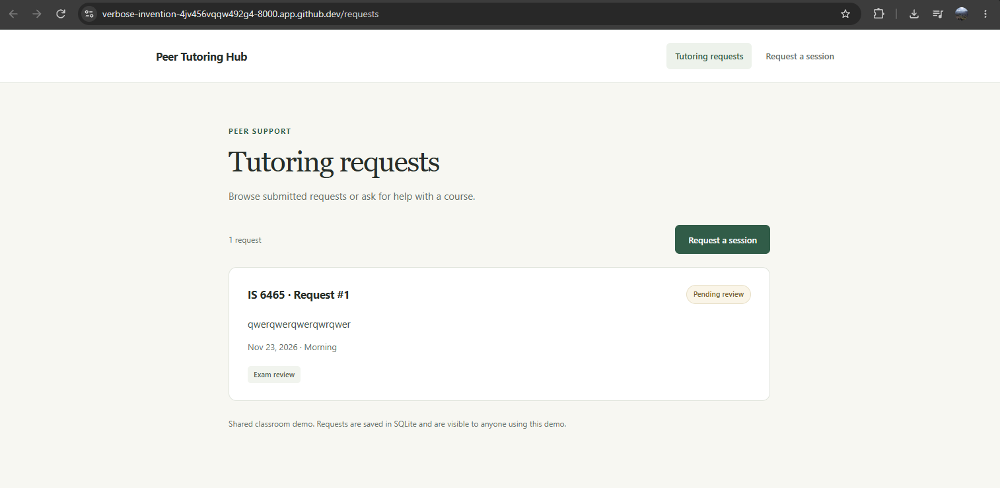
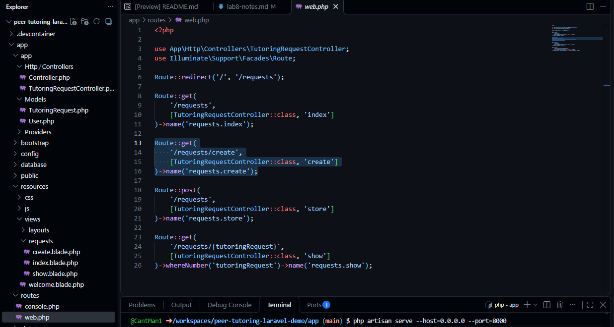
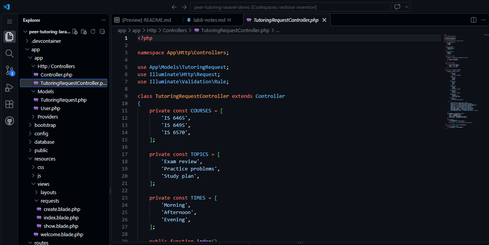
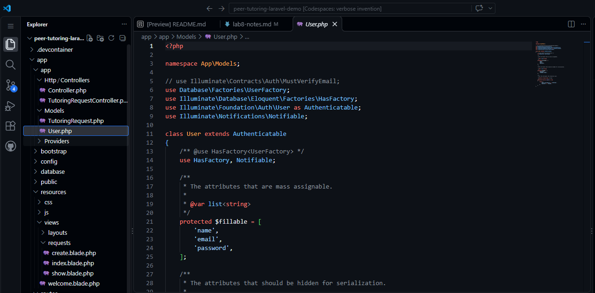
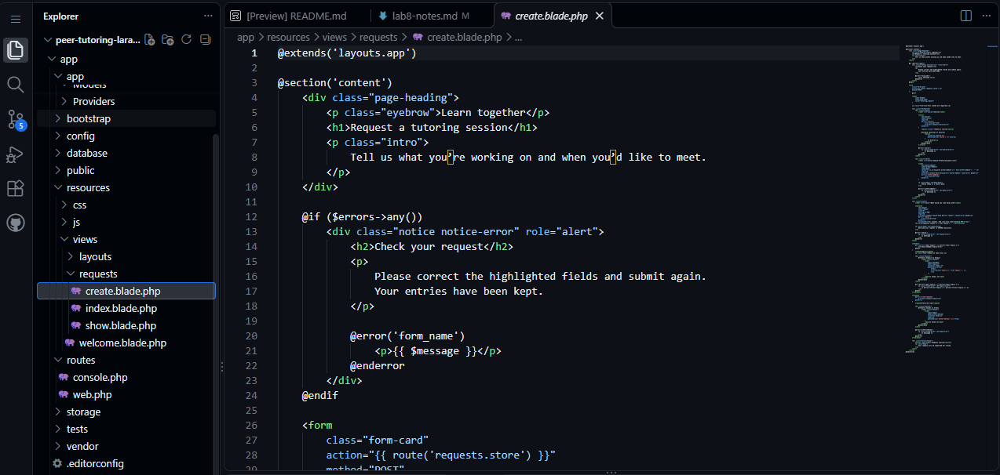

The peer tutoring application allows students taking a certain list of courses/attending a specific univeristy the ability to schedule a tutoring appointment. Ultimately, the business case of this application is to provide students of the host course[s]/university the ability to gain a better understanding of the course material through an online tutoring environment. 

One route used by the application:
Route::get(
    '/requests/create',
    [TutoringRequestController::class, 'create']
)->name('requests.create');

Accessing /requests/create causes this route to run.

A controller involved in one application workflow is TutoringRequestController, and its responsible for validating submitted form data.

TutoringRequest is one model used in this application, and the business data it represents is the students' requests and all associated data with each request.

One Blade template in this application is create.blade.php, and it holds the html for the tutoring request form page. 

For the tutoring request workflow, the user clicks the "Request a session" button, the route calls TutoringRequestController.php, and TutoringRequestController.php returns the create.blade.php view.

It seems like the primary use-case for leveraging Laravel is that it segregates each major functionality of the web application. For smaller projects like Lab6/7, I think it would be more effort to integrate than its worth. However, when the scale of the application expands, having the ability to easily call back to set templates and built-in functions within Laravel would make expansion and code management a lot easier. I think the main reason we arent being asked to convert at this point is because an application leveraging Laravel should be built from the ground up, rather than starting with a different framework and attempting to integrate laravel halfway through.

Running Laravel application:

Route:

Controller:

Model:

View:

It was nice that laravel segregated different functionalities of the application, and it was also nice that it comes with built-in features. However, I think initially it adds a lot of complexity and confusion to the application layout that was not previously there. I think to fully leverage laravel, it would probably be easier to start building the application with laravel in mind rather than trying to integrate it halfway through.
